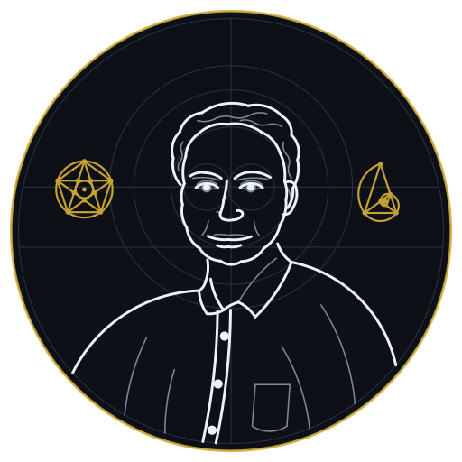

:site_title: Mario Livio

.. container:: author-overline

   semantic digital archive • mathematical catalog

===========
Mario Livio
===========

Astrophysicist **Mario Livio** brought a keen historical and scientific lens to *The Golden Ratio: The Story of Phi, the World's Most Astonishing Number* (2002), separating genuine mathematical elegance from centuries of numerological legend. Alongside real theorems spanning Hippasus's pentagram descent, Piero della Francesca's polyhedra, Penrose quasicrystals, and Benford's Law, Livio rigorously audited popular claims about the Great Pyramid, the Parthenon, and Renaissance canvases. This mathematical catalog encodes his nine chapters and ten appendices into exact SymPy invariants over $\mathbb{Q}(\phi)$ paired with an empirical myth-triage ledger.

Inside This Reference
---------------------

.. container:: home-book-hero no-thumb

   .. container:: home-book-body

      .. rubric:: Broadway Books · 2002 · 9 Chapters · 10 Appendices · 48 Entries

      **The Golden Ratio — Mathematical Catalog, Myth Triage & Concordance** — 48 atomic catalog entries (``LIV-01.01`` through ``LIV-APP.10``) uniting exact symbolic algebra in ``geometor.livio.invariants`` with a structured myth-triage ledger and a five-way golden-ratio concordance.

      .. container:: home-actions

         * :doc:`Open Mathematical Catalog → <catalog/index>`
         * :doc:`Explore Demos → <demos/index>`
         * :doc:`Python Modules → <modules/index>`

Key Features
------------

.. container:: home-feature-grid

   .. container:: home-feature-card

      **48 Exact $\mathbb{Q}(\phi)$ Verifiers**

      Every theorem—from Piero della Francesca's five-circle packing and al-Khwarizmi's golden division to the $120^\circ$ Golden Fractal Tree—is proved in exact SymPy algebra with zero float approximations.

   .. container:: home-feature-card

      **Empirical Myth-Triage Ledger**

      Separates verified physics and mathematics (Sanskrit *mātrā* prosody, Douady–Couder droplets, quasicrystals) from debunked folklore (Khufu's pyramid, Fechner bias, *Vitruvian Man*).

   .. container:: home-feature-card

      **Five-Way Corpus Concordance**

      Maps Livio's historical and algebraic examples directly across the ``divine``, ``huntley``, ``knott``, and ``posamentier`` catalogs.

Reference & Project
-------------------

.. container:: home-columns

   .. container:: home-col

      .. rubric:: Scholarly Apparatus

      * :doc:`People <people/index>` — Profiles of Mario Livio, Roger Herz-Fischler, Piero della Francesca, and cited scholars
      * :doc:`Bibliography <bibliography>` — Primary 2002 edition and historiographic literature
      * :doc:`Glossary <glossary>` — Key definitions of *tomē*, *seked*, quasicrystals, and golden-ratio invariants

   .. container:: home-col

      .. rubric:: About This Project

      * :doc:`About <about/index>` & :doc:`Using This Edition <usage/index>` — Editorial scope, symbolic methodology, and reading guide
      * :doc:`Project Log <log/index>` & :doc:`Todos <todos/index>` — Development notes and curation roadmap
      * :doc:`Changelog <changelog>` & :doc:`Connect <connect>` — Release history and GEOMETOR community links

.. toctree::
   :hidden:
   :maxdepth: 2

   catalog/index
   about/index
   people/index
   bibliography
   usage/index
   demos/index
   todos/index
   log/index
   modules/index
   glossary
   changelog
   connect
